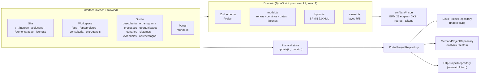

# LOOP v1.0 — aplicação web (front-end funcional)

Site da consultoria, Workspace do Consultor, LOOP Studio e Portal do Cliente numa única SPA. Roda **sem backend**: os dados ficam no navegador (IndexedDB) e todo dado de exemplo está marcado.

Origem do desenho: protótipo `LOOP.dc.html` do Claude Design (cópia em `docs/loop-app/design/`) e handoff `LOOP-HD-001` (rotas, tokens e caminhos de aceite).

## Executar

Requer Node ≥ 20. Na raiz do monorepo:

```bash
npm install
```

```bash
npm run dev -w @adm/loop
```

Abra `http://localhost:5173/`. Outros comandos (rode dentro de `apps/loop` ou com `-w @adm/loop`):

| Comando | O que faz |
|---|---|
| `npm run build` | Typecheck (`tsc`) + build de produção em `dist/` |
| `npm run preview` | Serve `dist/` em `http://localhost:4173/` |
| `npm test` | Vitest: domínio, schema, BPMN, mapa causal, repositórios, store, `models/` |
| `npm run e2e` | Playwright: 8 caminhos de aceite do handoff + responsividade (precisa do build) |
| `npm run zip` | Gera `release/loop-v1.0.zip` (código + `dist/` + modelos) |
| `npm run deploy` | Build + `wrangler pages deploy dist` (precisa de `wrangler login` ou `CLOUDFLARE_API_TOKEN`) |

## Arquitetura



- **Dados primeiro.** `src/data/*.json` é a fonte do BPM da consultoria (23 atividades, 7 fases, 5 gates), dos 9 blocos 3×3, das 5 regras de oportunidade e dos tokens. `src/domain/schema.ts` (Zod) define o projeto; tipos, validação de importação, formulários e `models/loop.project.schema.json` derivam dele.
- **Domínio sem UI.** `src/domain/` é a tradução tipada de `loop-core.js`. Não tem cores, rede nem IA generativa.
- **Portas e adaptadores.** As telas usam só `ProjectRepository`. Hoje: IndexedDB (Dexie), com memória como fallback quando o navegador bloqueia o armazenamento. `HttpProjectRepository` fixa os endpoints do backend futuro e falha explicitamente.
- **Rotas por hash** (`#/app/projetos/demo`): links profundos funcionam em qualquer hospedagem estática. Páginas pesadas carregam sob demanda (Recharts, ELK.js, bpmn-js).

## Stack

React 19 · TypeScript 5.9 · Vite 8 · Tailwind CSS 4 com componentes no padrão shadcn/ui (`cva` + `tailwind-merge`, em `src/components/ui`) · React Flow 12 (organograma, fluxo, mapa causal) · ELK.js (layout automático) · bpmn-js (visualização BPMN) · Motion (Play, transições, apresentação) · Zustand · React Hook Form + Zod · Dexie (IndexedDB) · Recharts · React Router 8 · Vitest + Playwright.

Os componentes de UI seguem o padrão do shadcn/ui, mas foram escritos à mão com elementos HTML nativos. Não usam Radix nem o CLI do shadcn.

## Design tokens

Do handoff `ROUTES_AND_DESIGN_TOKENS.json` (cópia em `src/data/design-tokens.json`), declarados em `src/styles.css` (`@theme`). Os componentes usam classes de token (`bg-paper`, `text-muted`, `border-stroke`, `text-red`…), não hex soltos. Tipografia: Inter, base 14 px.

## Estrutura

```
src/
  data/        modelos JSON (BPM, 3×3, regras, tokens)
  domain/      schema (Zod), model, bpmn, causal, self-tests + testes
  ports/       ProjectRepository + adaptadores Dexie, memória, HTTP
  store/       Zustand
  components/  ui/ (primitivos), diagrams/ (React Flow, bpmn-js), shell/
  pages/       site/, workspace/, studio/, portal/
models/        JSON Schema do projeto + exemplos exportados (sincronizados por teste)
e2e/           Playwright
```

## Limites desta versão

- Sem backend, login, envio de mensagens ou IA em execução. Perfis do portal são simulados.
- Play é progressão visual, não execução BPMN. O XML BPMN é de notação (`isExecutable="false"`).
- Sem motor de System Dynamics: tempo de ciclo, custo e ROI ficam “não calculável”. O mapa causal é qualitativo.
- Regras de oportunidade são correspondência determinística de fatos, não DMN completo. Um candidato não é ganho comprovado.
