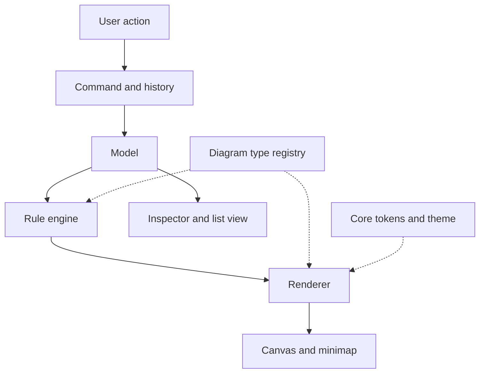

# System architecture and rules

Status: consolidated documentation baseline. Describes intended architecture, not verified application code.

## Layers and boundaries

| Layer | Prefix | Owns | Allowed dependency |
| --- | --- | --- | --- |
| Core | ds- | Neutral colors, type, spacing, radii, icons | None |
| Theme | theme- | Light and dark assignments to core colors | Core contract |
| Component | bpmn-, org-, flow-, map-, editor-, stack- | Family geometry and behavior | Core and same family |
| Diagram palette | bpmn-color-<family>-* | Six semantic route color families | Independent palette contract |
| Reference | None | Images, measured estimates, provenance | Documentation only |

Components MUST NOT read another family's tokens. Shared tokens MUST move into core. Component colors MUST use core aliases, except approved diagram palette colors. Shell, toolbar, inspector and panel colors MUST remain neutral. Themes MUST replace core values; family aliases MUST follow them. A reference measurement MUST be documented and approved as a token or literal before use in application code.

Selection MUST use a 2px ring based on ds-color-title in every view. Keyboard focus MUST remain identifiable when a node is also selected. The historical blue BPMN accent is superseded for selection and focus; its source value remains in the archive.

Hue is allowed for semantic diagram coloring and validation badges. Existing source descriptions disagree about connectors, role glyphs and full-node error coloring; these scopes remain open in the decision register. They MUST NOT silently expand the current allowance.

## Modules and responsibilities

| Module | Responsibility |
| --- | --- |
| EditorTopBar, EditorRail, Palette | Editing controls and registered tools |
| Canvas, CanvasControls, Minimap | Main view, navigation and overview |
| Inspector | Selected element details; tab names remain proposed |
| DiagramType registry | Register bpmn, processMap, orgChart and flowMap capabilities |
| Model | Elements, relationships and documentation |
| Command / History | Reversible edits, undo and redo |
| RuleEngine | Modeling checks, route/color resolution, layout hints |
| Renderer | Draw model, selection and validation results |
| ListView | Accessible representation of the same model |
| ThemeProvider | Apply core theme values |

RuleEngine MUST NOT draw. Renderer MUST NOT validate. The shell MUST obtain diagram capabilities through the registry. The stack family is a documented pattern; registration as a fifth diagram type remains undecided.

## Edit flow

This diagram restates the documented edit flow. Error handling, command rejection and persistence transactions still need an implementation contract. The source proposes BPMN XML with flat colors; preservation of non-BPMN families is unresolved, so universal XML round-trip support MUST NOT be claimed.

## View-specific rules

The [earlier app specification](archive/bpm-app-source.md) supplies processMap bands, stage gates, numbered documents, experience measures and proposed sizes. Those details remain applicable except where current boundary rules or open decisions explicitly qualify them. The [component index](components/README.md) points to the complete family detail.
